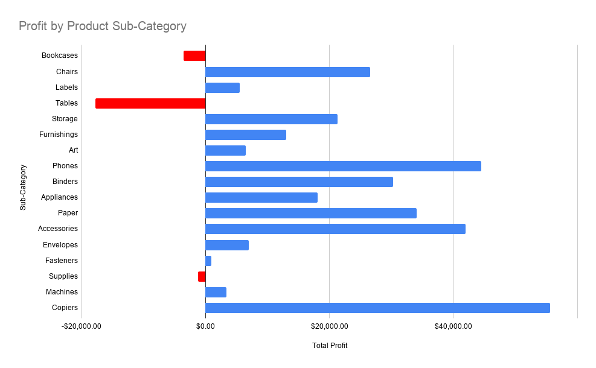

# Superstore Business Performance Analysis

## Project Overview

This project analyzes Superstore's sales, profitability, customer purchasing behavior, and regional performance using Google Sheets and Excel.

The goal is to identify business trends, investigate potential profitability issues, and develop data-driven recommendations.

**Project Status:** In Progress

**Tools:** Google Sheets, Excel, Pivot Tables, Data Cleaning, and Spreadsheet Formulas.

**Dataset:** [Superstore Dataset — Kaggle](https://www.kaggle.com/datasets/vivek468/superstore-dataset-final)

## Business Questions & Key Findings

### 1. How profitable is Superstore?

- **Total Sales:** $2,297,200.86
- **Total Profit:** Approximately $286,397
- **Profit Margin:** 12.47%

**Insight:** Superstore is profitable overall, but profitability varies significantly across product categories.

### 2. Which product sub-category generates the highest losses?

- **Tables Total Loss:** $17,725.48
- **Tables Profit Margin:** -8.56%

**Insight:** Tables generated the largest total loss among loss-making sub-categories. Higher discounts were associated with lower profit margins.

### 3. Which states generate the highest losses from Tables?

- **New York:** -$4,535.64
- **Illinois:** -$4,309.74
- **North Carolina:** -$3,684.25

**Insight:** The state with the highest total loss is not necessarily the state with the worst profit margin.

### 4. Which customer segment performs best?

- **Highest Sales:** Consumer ($1,161,401)
- **Highest Profit Margin:** Home Office (14.03%)

**Insight:** Higher sales volume does not always translate into a higher profit margin.

### 5. How important are repeat customers?

- **Unique Customers:** 793
- **Repeat Customers:** 781
- **Repeat Customer Rate:** 98.49%
- **Repeat Customer Sales:** $2,292,033.22
- **Sales Contribution:** 99.78%

**Insight:** Customers who placed multiple orders accounted for nearly all sales during the analyzed period. This measures repeat purchasing within the dataset, not long-term customer retention.

## Skills Demonstrated

### Data Preparation & Quality Assessment
- CSV data exploration
- Missing value detection using COUNTBLANK
- Data cleaning validation using TRIM and EXACT
- Unique record analysis using COUNTUNIQUE
- Initial duplicate assessment

### Data Analysis
- Sales and profit analysis
- Profit margin calculations
- Product and regional profitability analysis
- Discount analysis
- Customer segmentation
- Repeat purchase analysis

### Google Sheets & Excel
- Pivot Tables
- SUM, SUMIF, COUNTIF, COUNTA, COUNTUNIQUE
- IF statements and conditional logic
- Cross-sheet cell references
- Percentage calculations

### Business Analytics
- Defining business questions
- Interpreting KPIs
- Identifying potential causes of losses
- Developing data-driven recommendations
- Documenting analytical findings

## Data Visualizations

### Profit by Product Sub-Category

